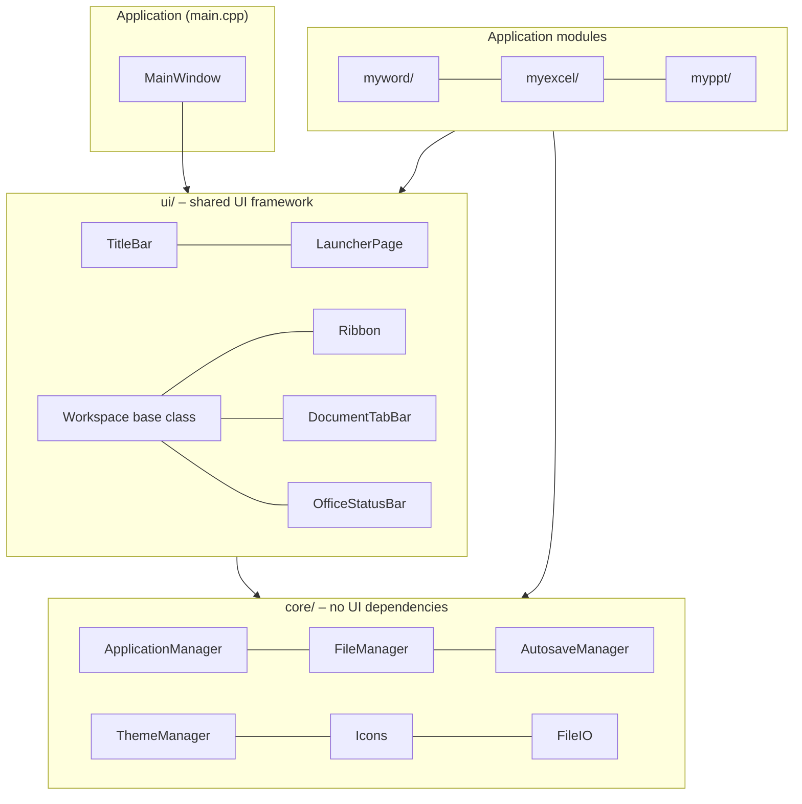
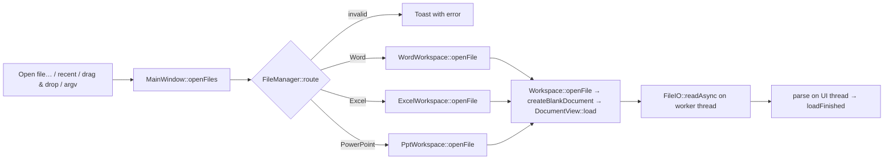

# Architecture

## 1. The big picture

MyOffice is one executable with three layers.



| Layer | Directory | Rule |
|---|---|---|
| **Core** | `core/` | Services and data helpers. May use `QtCore`, `QtGui` and `QtSvg`, but contains no application-specific screens. |
| **UI framework** | `ui/` | Reusable widgets and the base classes `Workspace` and `DocumentView`. Knows nothing about Word, Excel or PowerPoint. |
| **Applications** | `myword/`, `myexcel/`, `myppt/` | Each app subclasses `Workspace` (ribbon + status bar) and `DocumentView` (the editor for one document). |

Each module is added to the root project with a `.pri` file (`core/core.pri`, `ui/ui.pri`, `myword/myword.pri`, …). **When you add a source file, add it to the matching `.pri`.**

## 2. Startup sequence

```mermaid
sequenceDiagram
    participant main as main.cpp
    participant TM as ThemeManager
    participant MW as MainWindow
    main->>main: QApplication, Fusion style, app font
    main->>TM: ThemeManager::instance() (reads QSettings, builds palette)
    main->>MW: construct (frameless window, launcher page)
    main->>MW: show()
    main->>MW: QTimer::singleShot(0) → checkRecovery(); openFiles(argv)
```

`MainWindow` creates the launcher immediately and creates each app **lazily** (`ensureWord()`, `ensureExcel()`, `ensurePpt()`) the first time it is needed, so startup stays fast.

## 3. Navigation

`ApplicationManager` (singleton) stores *where the user is*: the launcher (`atHome()`) or one app (`currentApp()`). It emits `navigationChanged()`. `MainWindow::onNavigationChanged()` reacts by

1. calling `ThemeManager::setActiveApp(id)` — this recolours the title bar, tab bar, ribbon accent and status bar;
2. updating the title-bar breadcrumb (`MyOffice › MyWord`);
3. creating the workspace if necessary and creating a blank document if it has none;
4. cross-fading to the page with `FadeStack::fadeTo()`.

Closing the last tab of an app emits `Workspace::allDocumentsClosed()`, which sends the user back to the launcher.

## 4. Opening a file



* `FileManager::route(path)` checks that the file exists, is readable, is below the 2 GB limit, picks the app from the extension, verifies the `PK\x03\x04` signature for DOCX/XLSX/PPTX, and falls back to MyWord for unknown **text** files (it looks for NUL bytes in the first 8 KB).
* `Workspace::openFile(path, viewMode)` reuses an existing tab if the file is already open.
* `DocumentView::load()` reads the bytes asynchronously (`FileIO::readAsync`), then parses them on the UI thread and emits `loadFinished(ok, error)`. On failure the tab is closed and a toast is shown.
* **View mode** is a flag on the document. `Workspace` shows `ViewBanner` and disables every action that was created with `editsDocument = true`.

## 5. The two base classes

### `DocumentView` (`ui/workspace/workspace.h`)
One open document (one tab). Pure virtual interface:

```cpp
QString displayName() const;      QString filePath() const;
bool isModified() const;          bool save();   bool saveAs();
bool isViewMode() const;          void setViewMode(bool on);
void load(const QString &path, bool viewMode);   // async; emits loadFinished()
virtual void aboutToClose();      virtual void activated();
```
Signals the workspace listens to: `titleChanged`, `modifiedChanged`, `viewModeChanged`, `stateChanged` (ribbon should refresh), `statusChanged` (status bar should refresh), `loadFinished`, `message(text, kind)` (toast).

### `Workspace` (`ui/workspace/workspace.{h,cpp}`)
The shell around documents: tab bar, ribbon, view-mode banner, a `FadeStack` of documents and a status bar. It owns the **common actions** (New, Open, Save, Save As, Close), tab handling and the unsaved-changes prompt. A concrete app implements:

```cpp
DocumentView *createBlankDocument() override;   // factory
void syncState() override;    // update ribbon check-states/enabled flags from the current document
void syncStatus() override;   // update status-bar labels
```
and builds its ribbon in its constructor (`buildFile()`, `buildHome()`, …).

## 6. Data flow between ribbon and document

```
Ribbon button (RibbonButton) ──triggers──▶ QAction ──lambda──▶ wordDoc()->setBold(true)
                                                                       │
Document changes (cursor moved, text changed) ──emit stateChanged()────┘
        │
        ▼
Workspace::syncState()  →  ribbon check-states, combo boxes, enabled flags
```

Ribbon buttons never hold document pointers. Lambdas ask the workspace for the **current** document (`wordDoc()`, `excelDoc()`, `pptDoc()`) every time, so switching tabs just works.

## 7. Theming

`ThemeManager` (singleton) holds a `Palette` struct (`window, surface, surfaceHover, border, text, textSecondary, accent, accentDeep, danger, canvas, chrome, chromeText`). It also builds a `QPalette` and installs it on the application, so stock widgets (combo boxes, menus, message boxes) match. Custom widgets read `ThemeManager::instance().palette()` inside `paintEvent` and connect to `themeChanged()` to repaint.

While an app is active, `accent` and `chrome` take that app's colour (`ApplicationManager::info(id).accent`). `chromeText` is white on a coloured title bar.

Design constants (spacing, radii, type sizes, durations, window metrics) live in `core/designtokens.h`.

## 8. Threading model

* **UI thread:** everything that touches widgets, documents and models.
* **Worker thread:** `FileIO::readAsync()` (disk reads) and `AutosaveManager`'s atomic file write. Results return to the UI thread through queued signals.
* Parsing (DOCX/XLSX/PPTX) currently runs on the UI thread after the bytes are read. Moving it to a worker for very large files is a listed roadmap item.

## 9. Undo/redo strategies

| App | Strategy |
|---|---|
| MyWord | `QTextDocument`'s built-in undo stack. |
| MyExcel | `QUndoStack` with `CellsCommand` (per-cell edits) and `SnapshotCommand` (structural changes such as sort/insert/delete). |
| MyPowerPoint | Whole-deck snapshots (`Snap { Deck, current slide, serial }`), up to 100 steps. `QImage` is implicitly shared, so snapshots are cheap. Dirty state = `m_serial != m_savedSerial`. |

## 10. Persistence (QSettings)

Organisation/application name: `MyOffice`.

| Key | Meaning | Default |
|---|---|---|
| `appearance/mode` | 0 system, 1 light, 2 dark | 0 |
| `appearance/reduceMotion` | disable animations | false |
| `files/recent` | up to 20 recent paths | empty |
| `files/lastDir` | last used directory in file dialogs | empty |
| `files/openInViewMode` | open files read-only first | true |

Environment variable `MYOFFICE_REDUCE_MOTION=1` forces reduced motion (on Windows the OS "animations off" setting is honoured too).

## 11. Window system

`MainWindow` is a frameless, translucent `QWidget`. A 12 px outer margin hosts the drop shadow (drawn with layered rounded rectangles — no `QGraphicsDropShadowEffect`) and the **resize hit-zones** (`startSystemResize`). The inner `Surface` widget paints the rounded body. Dragging the title bar uses `startSystemMove()`. When maximized the margin and radius become 0.
