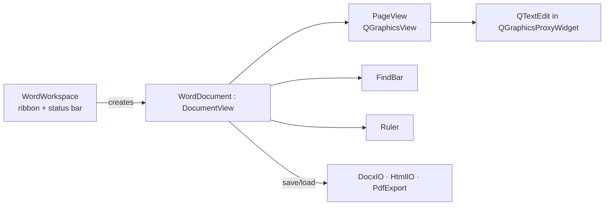

# MyWord internals (`myword/`)

```
myword/
├── document/   pagesetup.h  worddocument.{h,cpp}
├── editor/     pageview  ruler  findbar  wordworkspace
└── importexport/ docxio  htmlio  pdfexport
```

## Class overview



### `PageSetup` (`document/pagesetup.h`)
Plain struct shared by the editor and exporters: `widthMm, heightMm` (portrait), `landscape`, four margins in mm, `pageNumbers`. Helpers: `pageSizePx()`, `marginsPx()`, `contentSizePx()` (96 dpi pixels).

### `PageView` (`editor/pageview.*`)
A paper-style canvas. A `QTextEdit` lives inside a `QGraphicsProxyWidget`, so the view can **zoom with real vector scaling** (text stays editable and sharp). The "sheet" and its shadow are painted in `drawBackground()`; dashed page-break hints in `drawForeground()`. The edit widget is as tall as the document, so the view's scroll bar does the scrolling. Margins are applied with the edit's content margins.

| Method | Purpose |
|---|---|
| `setPageSetup(ps)` / `pageSetup()` | Re-layout for size/margins |
| `setZoom(z)` / `zoom()` / `fitWidth()` | Zoom factor 0.25–4.0; Ctrl + wheel zooms |
| `pageCount()` / `pageOfCursor()` | Approximate page numbers from document height ÷ content height |
| `ensureCursorVisible()` / `focusEditor()` | Scroll & focus helpers |
| signal `zoomChanged(qreal)` | |

> Layout is continuous on screen; exact pagination happens in `PdfExport`.

### `Ruler` (`editor/ruler.*`)
Horizontal ruler (22 px). Reads the view's zoom, horizontal scroll and page setup; draws the page band, margin shading, centimetre/millimetre ticks measured from the left margin and margin markers. Call `refresh()` after page setup changes.

### `FindBar` (`editor/findbar.*`)
Inline find & replace. `open(withReplace)`, `findNext(backward)`, live match highlighting via `QTextEdit::setExtraSelections` (max 5000 matches), *Replace all* in a single undo step (`beginEditBlock`).

### `WordDocument` (`document/worddocument.*`)
One document tab. Implements `DocumentView` and the editing commands:

| Group | Methods |
|---|---|
| Character | `setFontFamily`, `setFontSize`, `setBold`, `setItalic`, `setUnderline`, `setStrike`, `setTextColor`, `setHighlight(color, clear)`, `clearFormatting` |
| Paragraph | `setAlignment`, `toggleList(style)`, `changeIndent(±1)`, `setLineSpacing(percent)`, `setParagraphSpacing(beforePt, afterPt)`, `applyStyle(index)` (0 Normal, 1 Title, 2–4 Heading 1–3, 5 Quote) |
| Insert | `insertTable(rows, cols)`, `tableOp(op)`, `insertImage()`, `insertLink()`, `removeLink()`, `insertPageBreak()` |
| Page | `pageSetup()`, `setPageSetup(ps)`, `setPageNumbers(bool)`, `setRulerVisible(bool)` |
| State | `formatState()` → `FormatState` (bold, family, size, alignment, list style, heading, in-table, selection, can-undo/redo), `stats()` → `Stats` (words, characters, paragraphs, pages, current page) |
| Files | `load` (async), `save`, `saveAs`, `exportTo(path)`, `exportDialog(suffix)`, `loadRecovery(html, id)` |

Behaviour worth knowing:

* **Signals → ribbon:** cursor movement, format change, undo availability and selection changes emit `stateChanged()`; content changes restart a 300 ms timer that emits `statusChanged()` (word count is computed lazily, not on every key press).
* **Link click:** Ctrl+click opens a hyperlink; in view mode a plain click does.
* **Autosave:** registers with `AutosaveManager` using the HTML-with-embedded-images writer.
* **Saving:** format is chosen by the file extension; writes go through `QSaveFile` (atomic).
* **Default font:** first available of Calibri, Segoe UI, Arial, Helvetica, Noto Sans, DejaVu Sans at 11 pt.

### `WordWorkspace` (`editor/wordworkspace.*`)
Builds the ribbon pages *File, Home, Insert, Layout, Review, View*, the status bar (page, words, mode, zoom slider) and implements `syncState()` / `syncStatus()`. Actions are created through `editAction()` (disabled in view mode) or `makeAction()`.

## Import / export

| Module | API | Notes |
|---|---|---|
| `DocxIO` | `QByteArray write(const QTextDocument*, const PageSetup&)`, `bool read(bytes, QTextDocument*, PageSetup*, QString *error)` | Paragraphs, runs, lists (numbering.xml), tables with spans, hyperlinks (read), page size/margins, headings. Details: [FILE_FORMATS.md](FILE_FORMATS.md#docx). |
| `HtmlIO` | `write(doc)`, `read(bytes, doc)` | Images are embedded as `data:` URIs on save and re-registered as document resources on load. |
| `PdfExport` | `bool write(doc, PageSetup, path, QString *error)` | Clones the document, paginates manually with `drawContents`, optional page numbers; 96 dpi device so layout matches the screen. |

Plain text, Markdown (`QTextDocument::toMarkdown/setMarkdown`) and ODT (`QTextDocumentWriter`, export only) use Qt directly.

## Document statistics

`WordWorkspace::showWordCount()` (Review → Document Statistics) reports pages, words, characters (with/without spaces), paragraphs, sentences, **reading time** (200 words/min), average word length, **Flesch reading ease** (heuristic syllable counter) with a plain-language level (Easy / Standard / Fairly difficult / Difficult) and the five most used words (stop-words and words ≤ 3 letters excluded).
